<div align="center">

# Memora
### AI Voice to Calendar & Tasks
**30 seconds of voice. Zero forgotten tasks.**
</div>


## 📑 Table of Contents

1. [What is Memora?](#-what-is-memora)
2. [Features](#-features)
3. [System Context](#1-system-context-diagram)
4. [End-to-End User Flow](#2-end-to-end-user-flow)
5. [Capture Pipelines A vs B](#3-capture-pipelines-a-vs-b)
6. [Full Sequence Diagram](#4-full-happy-path-sequence)
7. [Recorder State Machine](#5-recorder-state-machine)
8. [Layered Architecture](#6-layered-architecture)
9. [State Management Graph](#7-riverpod-provider-graph)
10. [ER Diagram](#8-er-diagram-local-database)
11. [Domain Class Diagram](#9-domain-class-diagram)
12. [Data Lifecycle](#10-data-lifecycle)
13. [Offline Queue](#11-offline-queue--auto-sync)
14. [Error Handling](#12-error-handling-decision-flow)
15. [Reminders & Calendar](#13-reminders--calendar-hand-off)
16. [Permissions Flow](#14-permissions-flow)
17. [Security Architecture](#15-security-architecture)
18. [UI Navigation & Wireframes](#16-ui-navigation-map--wireframes)
19. [Monetisation Gating](#17-monetisation--entitlement-flow)
20. [Roadmap & Plan](#18-development-roadmap)
21. [CI/CD & Release](#19-cicd--release-pipeline)
22. [Git Workflow](#20-git-workflow)
23. [Getting Started](#-getting-started)

> 💡 All diagrams are written in [Mermaid](https://mermaid.js.org/) and render natively on GitHub.

---

## ✨ What is Memora?

Capturing thoughts on the go is painful: unlock the phone, open a calendar, a to-do app and a notes app, then type everything out. Plain voice memos are fast, but they become a graveyard of audio files nobody listens to.

**Memora** is a single-button app. **Press and hold the mic, ramble for up to 30 seconds, release.** Within about two seconds, Google Gemini turns your unstructured speech into structured actions:

| Category | Colour | What you get |
| :-- | :-- | :-- |
| 📅 **Calendar events** | Electric Indigo `#6366F1` | Title, resolved date/time, duration, one-tap add to your native calendar |
| ✅ **To-Dos** | Emerald Mint `#10B981` | Actionable tasks with priority and an optional reminder alarm |
| 📝 **Notes** | Amber Gold `#F59E0B` | Cleaned-up thoughts with automatic tags |

### Example

> *"Set up a design sync with Sarah this Thursday at 11 AM for half an hour. Also remind me to renew the domain name tonight at 8 PM and pick up AA batteries. Oh, and a quick note for my podcast: open the next episode with the story about the 1998 server crash."*

```
📅 Calendar (1)  Design Sync with Sarah · Thu 11:00–11:30 AM        [+ Add to Calendar]
✅ To-Dos (2)    ☐ Renew domain name   ⏰ Today 8:00 PM · High
                 ☐ Pick up AA batteries · Low
📝 Notes (1)     Podcast Intro Idea — "Open the next episode with the story
                 about the 1998 server crash."  #Podcast #Content
```

---

## 🚀 Features

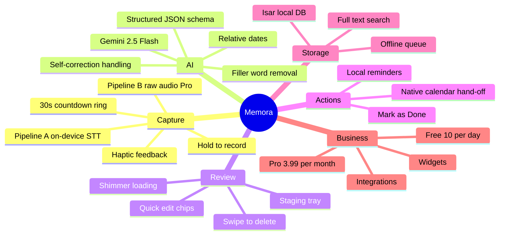

- **Hold-to-ramble capture** with haptics and a 30-second circular countdown ring
- **Dual audio pipelines:** on-device STT (live words) and multimodal raw audio (Pro, noisy/bilingual)
- **Structured AI output** using Gemini JSON schema, with no fragile text parsing
- **Smart understanding:** relative dates, self-corrections, filler-word removal
- **Review before saving:** quick-edit chips and swipe-to-delete
- **Native calendar hand-off** (no invasive OAuth) and **local reminders** with *Mark as Done*
- **Searchable workspace** (All Actions / Tasks / Notes) powered by Isar
- **Offline queue** that auto-processes recordings when you reconnect
- **Dark "Obsidian" UI** (`#0B0F19` background, `#161F30` cards)

---

# 🧭 Architecture & Plan: Everything in Diagrams

## 1. System Context Diagram

Who and what Memora talks to.

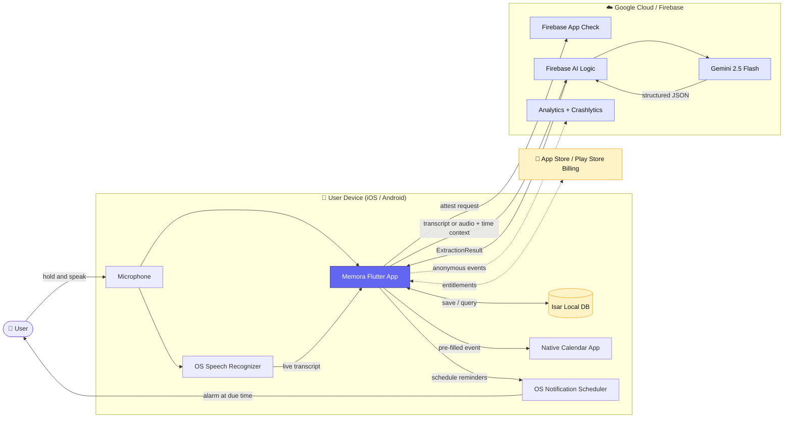

---

## 2. End-to-End User Flow

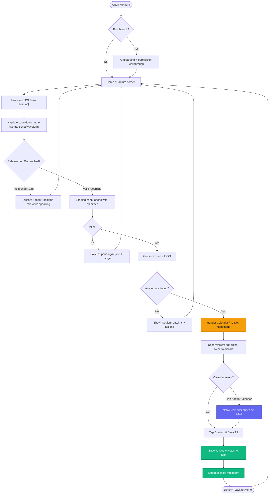

---

## 3. Capture Pipelines A vs B

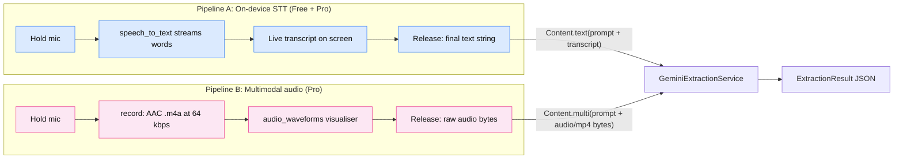

| | Pipeline A | Pipeline B (Pro) |
| :-- | :-- | :-- |
| Package | `speech_to_text` | `record` + `audio_waveforms` |
| Sent to Gemini | Transcript text | Raw `.m4a` (`audio/mp4`) |
| Best for | Instant feedback, zero audio bandwidth | Noise, heavy accents, bilingual speech |
| Max length | 30 s | 2 min |

---

## 4. Full Happy-Path Sequence

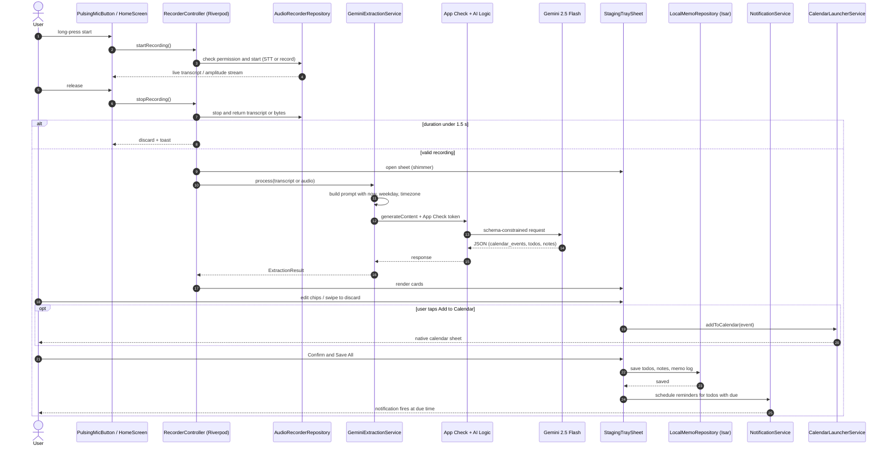

---

## 5. Recorder State Machine

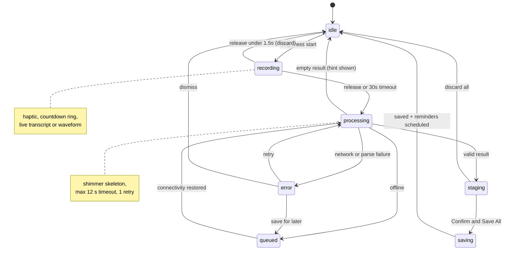

---

## 6. Layered Architecture

Feature-first clean architecture. Dependencies point **inward** (Presentation → Domain ← Data).

```mermaid
flowchart TB
    subgraph PRES["🎨 Presentation Layer"]
        direction LR
        S1["HomeRecorderScreen"]
        S2["WorkspaceTabsScreen"]
        W1["PulsingMicButton"]
        W2["StagingTraySheet"]
        W3["EventActionCard / TodoTile / NoteGridCard"]
        CT["RecorderController (Notifier)"]
    end

    subgraph DOM["🧠 Domain Layer (pure Dart)"]
        direction LR
        M1["ExtractionResult"]
        M2["ExtractedCalendarEvent"]
        M3["ExtractedTodo"]
        M4["ExtractedNote"]
        M5["SavedTodo / SavedNote / VoiceMemoLog"]
    end

    subgraph DATA["💾 Data Layer"]
        direction LR
        D1["AudioRecorderRepository"]
        D2["GeminiExtractionService"]
        D3["LocalMemoRepository"]
    end

    subgraph CORE["⚙️ Core"]
        direction LR
        C1["NotificationService"]
        C2["CalendarLauncherService"]
        C3["ConnectivityService"]
        C4["AppColors / DateTimeHelper"]
    end

    subgraph EXT["🔌 External"]
        direction LR
        E1["speech_to_text / record"]
        E2["firebase_ai + App Check"]
        E3["Isar"]
        E4["add_2_calendar"]
        E5["flutter_local_notifications"]
        E6["connectivity_plus"]
    end

    PRES --> DOM
    CT --> DATA
    CT --> CORE
    DATA --> DOM
    D1 --> E1
    D2 --> E2
    D3 --> E3
    C2 --> E4
    C1 --> E5
    C3 --> E6

    classDef pres fill:#6366F1,color:#fff,stroke:#312E81;
    classDef dom fill:#10B981,color:#fff,stroke:#065F46;
    classDef data fill:#F59E0B,color:#111,stroke:#92400E;
    classDef core fill:#E5E7EB,color:#111,stroke:#6B7280;
    class S1,S2,W1,W2,W3,CT pres;
    class M1,M2,M3,M4,M5 dom;
    class D1,D2,D3 data;
    class C1,C2,C3,C4 core;
```

### Folder structure

```text
lib/
├── main.dart
├── app.dart
├── core/
│   ├── constants/app_colors.dart
│   ├── services/ (notification, calendar_launcher, connectivity)
│   └── utils/date_time_helper.dart
└── features/
    ├── recorder/
    │   ├── data/         audio_recorder_repository, gemini_extraction_service
    │   ├── domain/       extraction_result_model
    │   └── presentation/ controllers, screens, widgets (pulsing_mic_button, staging_tray_sheet)
    └── workspace/
        ├── data/         local_memo_repository
        ├── domain/       calendar_item, todo_item, note_item
        └── presentation/ screens, widgets (event_action_card, todo_tile, note_grid_card)
```

---

## 7. Riverpod Provider Graph

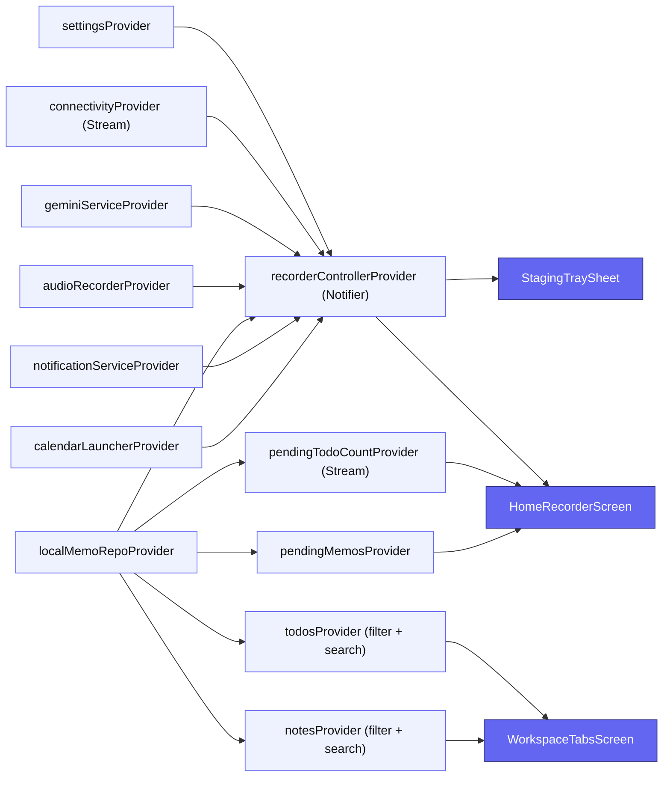

---

## 8. ER Diagram (Local Database)

Isar stores everything on-device. `VoiceMemoLog` is the **source record**; every saved To-Do, Note and Event log item links back to it via `sourceMemoUuid`. Tags are stored as an embedded list on `SavedNote` and shown here as a logical `NOTE_TAG` entity.

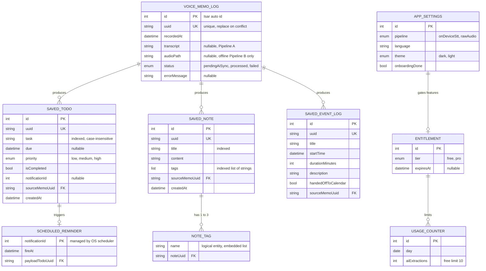

> `SAVED_EVENT_LOG`, `APP_SETTINGS`, `ENTITLEMENT` and `USAGE_COUNTER` are lightweight MVP-adjacent collections. Calendar events themselves live in the user's **native calendar**, not in Memora's database.

---

## 9. Domain Class Diagram

Transient AI models (parsed from Gemini JSON) and persistent models (Isar).

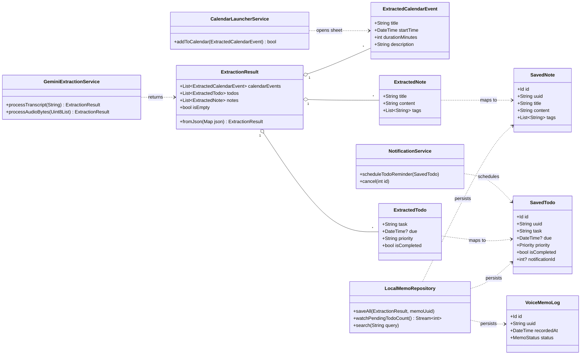

### AI JSON contract

```json
{
  "calendar_events": [
    { "title": "Design Sync with Sarah",
      "start_time": "2026-10-29T11:00:00+06:00",
      "duration_minutes": 30,
      "description": "Design sync with Sarah." }
  ],
  "todos": [
    { "task": "Renew domain name", "due": "2026-10-26T20:00:00+06:00", "priority": "high" },
    { "task": "Pick up AA batteries", "due": null, "priority": "low" }
  ],
  "notes": [
    { "title": "Podcast Intro Idea",
      "content": "Open the next episode with the story about the 1998 server crash.",
      "tags": ["Podcast", "Content"] }
  ]
}
```

---

## 10. Data Lifecycle

How raw voice becomes durable data, and what is deleted along the way.

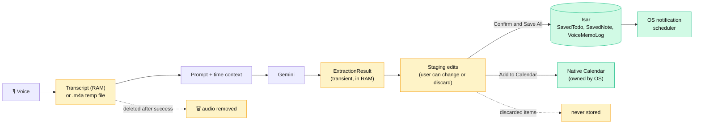

---

## 11. Offline Queue & Auto-Sync

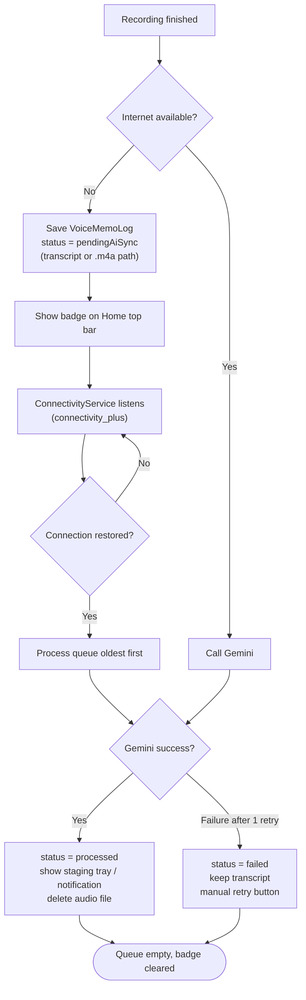

---

## 12. Error Handling Decision Flow

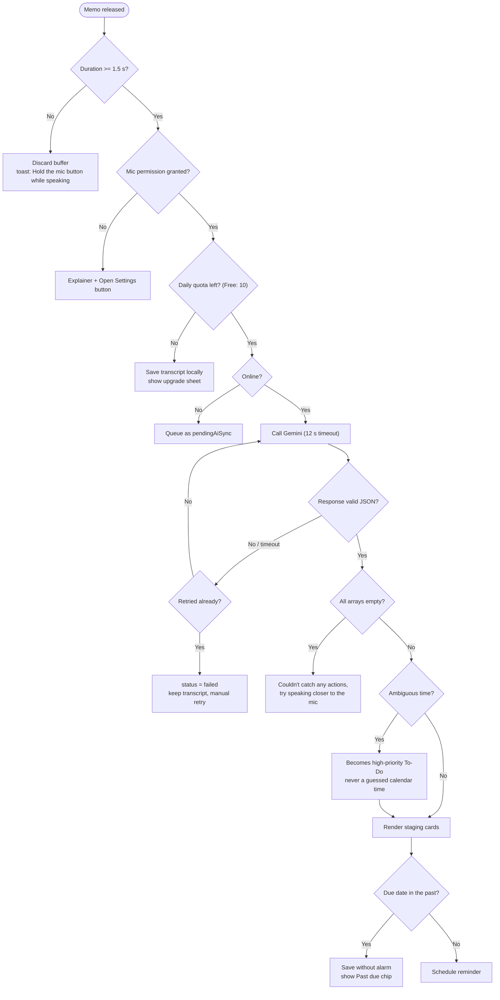

---

## 13. Reminders & Calendar Hand-off

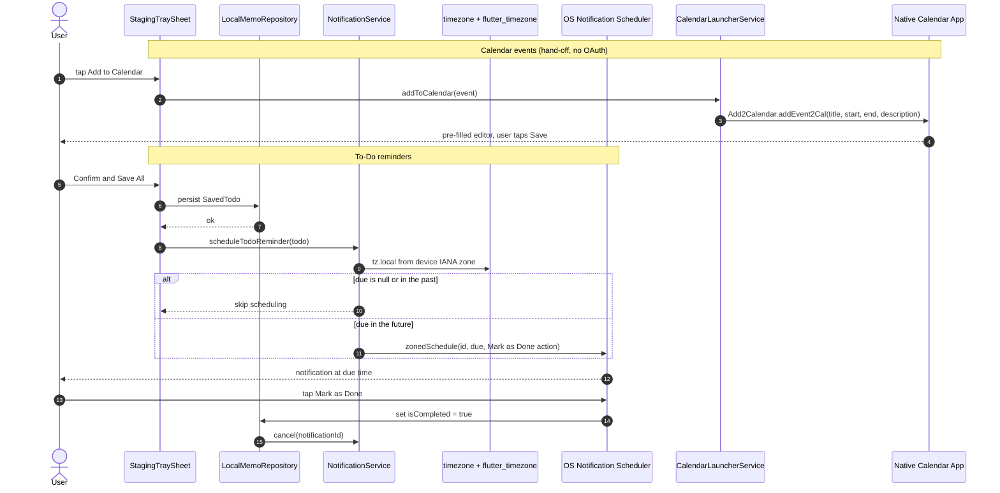

---

## 14. Permissions Flow

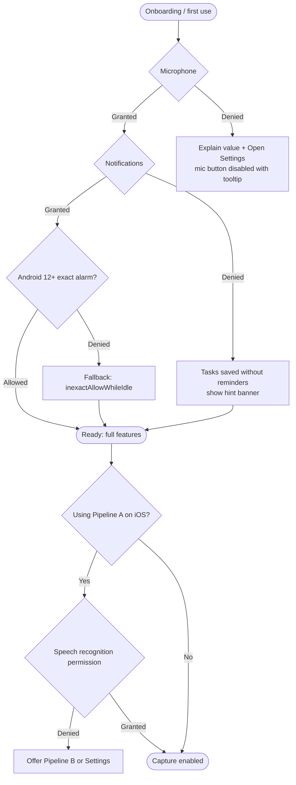

---

## 15. Security Architecture

No API keys ship inside the production app.

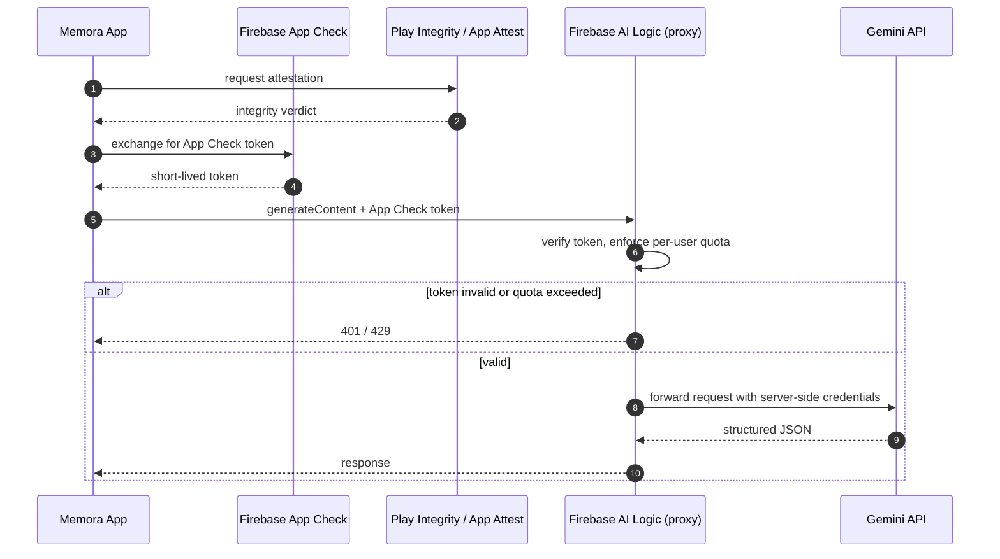

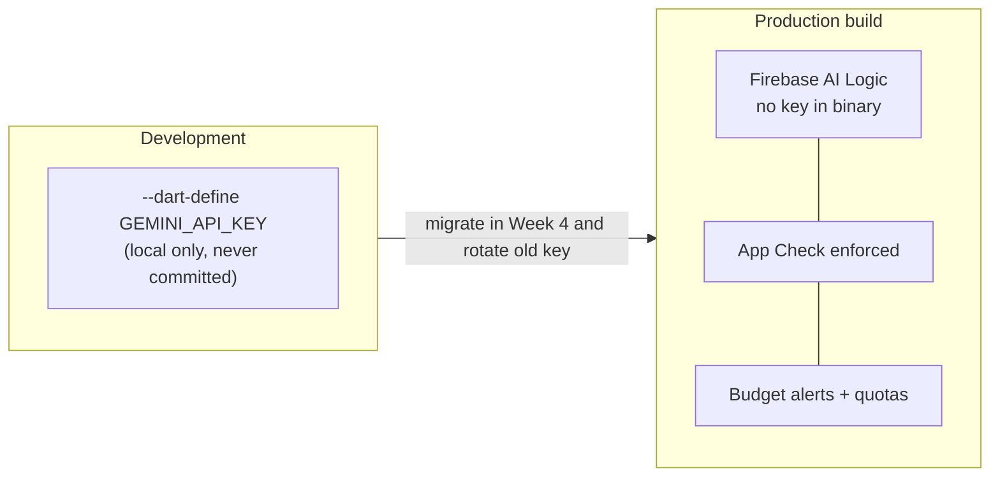

**Privacy principles:** local-first storage · audio deleted after processing · no transcripts in analytics · "Delete all data" in settings · AI-processing disclosure in privacy policy.

---

## 16. UI Navigation Map & Wireframes

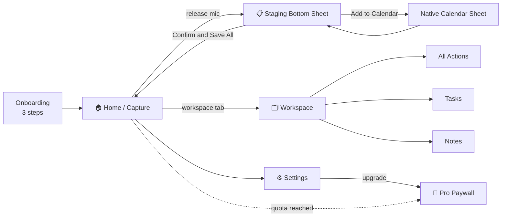

### Wireframes (text)

```
┌─────────────────────────┐   ┌─────────────────────────┐   ┌─────────────────────────┐
│ ✅ 3 tasks · 📅 2 today  │   │ ▔▔▔▔▔  (drag handle)    │   │ [All] [Tasks] [Notes]   │
│ ☁️ 1 pending sync        │   │ 📅 CALENDAR (1)         │   │ 🔍 search…              │
│                         │   │ Design Sync with Sarah  │   │ ☐ Renew domain   ⏰ 8PM │
│   "Set up a design      │   │ Thu 11:00–11:30  [+Cal] │   │ ☐ Pick up AA batteries  │
│    sync with Sarah…"    │   │ [+15 min] [Change time] │   │ ─────────────────────── │
│   ~~~~ waveform ~~~~    │   │ ✅ TO-DOS (2)           │   │ ┌──────────┐┌─────────┐ │
│                         │   │ ☐ Renew domain · High   │   │ │Podcast   ││ Idea…   │ │
│       ╭───────╮         │   │ ☐ Pick up AA · Low      │   │ │Intro #Pod││ #UI     │ │
│       │  🎙️   │ 28s ◔   │   │ 📝 NOTES (1)            │   │ └──────────┘└─────────┘ │
│       ╰───────╯         │   │ [   Confirm & Save All ]│   │                         │
└─────────────────────────┘   └─────────────────────────┘   └─────────────────────────┘
      Home / Capture                Staging Sheet                  Workspace
```

---

## 17. Monetisation & Entitlement Flow

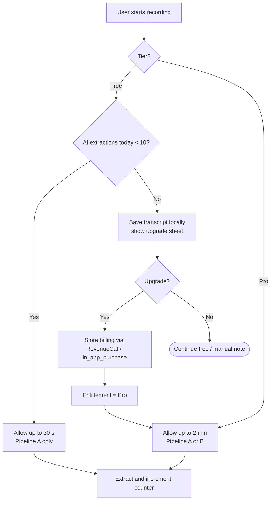

| | Free | Pro: $3.99 / month |
| :-- | :-- | :-- |
| Recording length | 30 s | up to 2 min |
| AI extractions | 10 / day | Fair-use unlimited |
| Audio pipeline | On-device STT | + Multimodal raw audio |
| Integrations | Native calendar hand-off | Google Calendar, Notion, Todoist (OAuth) |
| Widgets | n/a | Home & lock screen (`home_widget`) |

---

## 18. Development Roadmap

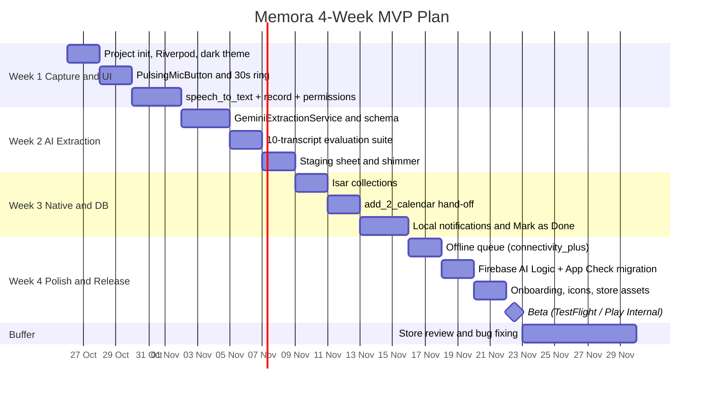

| Week | Focus | Exit criteria |
| :-- | :-- | :-- |
| **1** | Audio capture & UI shell | Hold-to-record works on both OSs; live transcript visible; permissions tested |
| **2** | Gemini structured extraction | ≥ 9/10 eval transcripts pass; staging sheet renders all categories |
| **3** | Native actions & local DB | Speak → review → save → reminder fires on time |
| **4** | Offline, security & release prep | No API key in binary; offline memo auto-syncs; beta builds uploaded |

### Post-MVP expansion

```mermaid
flowchart LR
    MVP(["MVP v1.0"]) --> V11["v1.1<br/>Pro tier + raw audio mode"]
    V11 --> V12["v1.2<br/>Widgets + shortcuts (Siri / Assistant)"]
    V12 --> V13["v1.3<br/>Google Calendar, Notion, Todoist sync"]
    V13 --> V20["v2.0<br/>Recurring items, location reminders,<br/>daily digest, team workspaces"]
```

---

## 19. CI/CD & Release Pipeline

```mermaid
flowchart LR
    DEV["Developer push / PR"] --> GH["GitHub Actions"]
    subgraph CI["Continuous Integration"]
        direction TB
        A1["flutter pub get"] --> A2["build_runner"]
        A2 --> A3["flutter analyze"]
        A3 --> A4["flutter test --coverage"]
        A4 --> A5["Nightly: AI eval suite vs live Gemini"]
    end
    GH --> CI
    CI -->|"green + review"| MERGE["Merge to develop"]
    MERGE --> REL["release/x.y.z branch"]
    REL --> BA["Build .aab (Android)"]
    REL --> BI["Build .ipa (iOS)"]
    BA --> IT["Play Internal Testing"]
    BI --> TF["TestFlight"]
    IT --> PROD["Production release"]
    TF --> PROD
    PROD --> MON["Crashlytics + Analytics + AI cost alerts"]
```

---

## 20. Git Workflow

```mermaid
gitGraph
    commit id: "init memora"
    branch develop
    checkout develop
    commit id: "design system"
    branch feature/mic-button
    commit id: "PulsingMicButton"
    commit id: "countdown ring"
    checkout develop
    merge feature/mic-button
    branch feature/gemini-extraction
    commit id: "schema + service"
    commit id: "eval suite"
    checkout develop
    merge feature/gemini-extraction
    branch release/1.0.0
    commit id: "store assets"
    checkout main
    merge release/1.0.0 tag: "v1.0.0"
```

---

## 🧱 Tech Stack

| Area | Technology |
| :-- | :-- |
| Framework | Flutter (Dart `>=3.5.0 <4.0.0`) |
| State management | `flutter_riverpod`, `riverpod_annotation` |
| Models | `freezed`, `json_serializable` |
| Audio | `speech_to_text`, `record`, `audio_waveforms`, `permission_handler` |
| AI | Gemini 2.5 Flash via `firebase_ai` (production) / `google_generative_ai` (prototype) |
| Device actions | `add_2_calendar`, `flutter_local_notifications`, `timezone`, `flutter_timezone` |
| Storage | `isar` |
| Connectivity | `connectivity_plus` |
| UI | `lucide_icons`, `shimmer`, `intl` |

---

## ⚙️ Getting Started

### Prerequisites

- Flutter SDK (stable) and Dart `>=3.5.0`
- Xcode (iOS) and/or Android Studio with an Android SDK
- A [Gemini API key](https://aistudio.google.com/app/apikey) for local prototyping
- (Production) a Firebase project with **Firebase AI Logic** and **App Check** enabled

### Installation

```bash
git clone https://github.com/masumtanjim7/Memora.git
cd Memora
flutter pub get
dart run build_runner build --delete-conflicting-outputs
```

### Run (prototype, direct API key)

```bash
flutter run --dart-define=GEMINI_API_KEY=your_key_here
```

> ⚠️ Never commit API keys. Direct-key mode is for local development only.

### Run (production, Firebase AI Logic)

```bash
dart pub global activate flutterfire_cli
flutterfire configure --project=<your-firebase-project>
flutter run --release
```

### First-time project creation

```bash
flutter create --org com.spideytech --project-name memora --platforms=android,ios memora
```

---

## 🔐 Permissions

| Platform | Permissions |
| :-- | :-- |
| **iOS** (`Info.plist`) | `NSMicrophoneUsageDescription`, `NSSpeechRecognitionUsageDescription`, `NSCalendarsUsageDescription`, `NSCalendarsFullAccessUsageDescription` |
| **Android** (`AndroidManifest.xml`) | `RECORD_AUDIO`, `INTERNET`, `ACCESS_NETWORK_STATE`, `READ_CALENDAR`, `WRITE_CALENDAR`, `POST_NOTIFICATIONS`, `SCHEDULE_EXACT_ALARM`, `RECEIVE_BOOT_COMPLETED`, `VIBRATE` |

---

## 🧪 Testing

```bash
flutter analyze
flutter test --coverage
flutter test integration_test
```

The AI layer ships with a 10-transcript evaluation suite (relative dates, self-corrections, filler words, ambiguous times, silence, code-switching) to guard extraction quality.

```mermaid
flowchart LR
    U["Unit tests<br/>models, helpers, controller"] --> W["Widget tests<br/>mic button, staging sheet, goldens"]
    W --> I["Integration tests<br/>record → stage → save → reminder"]
    I --> E["AI eval suite<br/>10 transcripts, ≥ 99% schema-valid"]
    E --> M["Manual device matrix<br/>Android 8–15, iOS 15+, offline, reboot"]
```

---

## 🛡️ Privacy

- No account required in the MVP
- Tasks and notes are stored locally on your device
- Only the current memo's transcript/audio is sent to Google Gemini; audio is deleted after successful processing
- No API keys are shipped in production builds (Firebase AI Logic + App Check)

---

## 🤝 Contributing

1. Open an issue to discuss your idea
2. Branch from `develop`: `feature/<short-name>`
3. Use [Conventional Commits](https://www.conventionalcommits.org/) (`feat:`, `fix:`, `docs:` …)
4. Ensure `flutter analyze` and `flutter test` pass
5. Open a pull request

---

## 📚 Documentation

Full product, architecture and release documentation: [`docs/Memora_Project_Documentation.docx`](docs/Memora_Project_Documentation.docx)

---

## 📄 License

Released under the MIT License (change this section if you choose a different license).

---

<div align="center">

**Memora** · Built with ❤️ by **SpideyTech**
`com.spideytech.memora`

</div>
